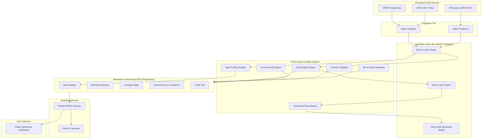

# Enterprise Data Quality & Governance Platform — System Architecture

## Architecture Overview

The platform uses a decoupled, event-driven, medallion-lakehouse architecture split into logical tiers:

1. **Ingestion Layer**: Python Ingestion scripts, Apache Kafka producers/consumers, REST API connectors.
2. **Lake Storage Layer (Medallion)**: MinIO (S3-compatible) hosting Bronze (raw), Silver (validated/clean), and Gold (governed marts) in Parquet format.
3. **Compute Engine Layer**: PySpark for scalable big data profiling, Great Expectations & custom Python rule engines for data quality checks, DuckDB/PostgreSQL for analytical queries.
4. **Metadata & Governance Core**: PostgreSQL metadata repository storing Data Catalog, Business Glossary, Lineage DAGs, Schema History, Quality Issues, Compliance Controls, Policy Violations, and Audit Logs.
5. **Observability & Alerting**: Prometheus exporter collecting pipeline metrics + Grafana dashboarding + Alert Engine (Kafka/Webhook).
6. **API Gateway & Services**: FastAPI REST backend enforcing JWT auth and fine-grained RBAC.
7. **User Interface**: React + TypeScript + Vite interactive dashboard with Recharts and graph visualization for lineage.

---

## High-Level Architecture Diagram (Mermaid)

---

## Technology Stack Justification

- **FastAPI + Async Python**: Lightweight, high performance, native Pydantic validation, automatic OpenAPI spec generation.
- **PySpark + DuckDB**: Allows running large scale data processing in local single-node or multi-node mode seamlessly without changing logic.
- **PostgreSQL**: Industry standard transactional metadata storage with strong ACID guarantees, JSONB support, and indexing capabilities.
- **MinIO**: 100% S3-compatible local object storage, allowing effortless eventual migration to AWS S3.
- **Apache Kafka**: High-throughput streaming platform to decouple event producers (ingestion, quality failures) from consumers (alerts, audit logger).
- **React + Vite + TypeScript**: Modern, type-safe frontend offering instant HMR, high performance rendering, and strong UI component ecosystem.
