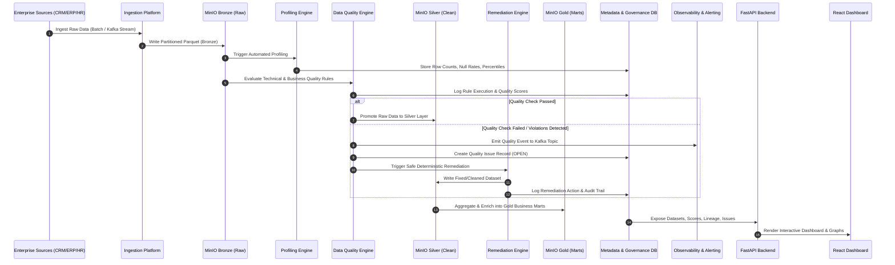

# Enterprise Data Quality & Governance Platform — Data Flow Architecture

## Reference Data Flow Lifecycle

## Layer Transitions & Data Contracts

1. **Source -> Bronze**:
   - Format: Raw CSV / JSON / DB dumps converted to raw Parquet format.
   - Validation: File arrival detection, metadata tracking.

2. **Bronze -> Profiling & DQ Check**:
   - Format: Parquet.
   - Validation: Schema enforcement against Data Contracts, Execution of 14+ Quality Rule Types, PII Classification.

3. **Bronze -> Silver**:
   - Format: Standardized Parquet.
   - Action: Quarantine failing rows or apply deterministic remediation (formatting, casing, phone normalization).

4. **Silver -> Gold**:
   - Format: Curated Star-Schema Marts (Parquet).
   - Action: Join cleaned dimensions & facts, aggregate business metrics, tag with ownership & glossaries.
