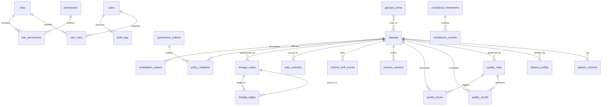

# Enterprise Data Quality & Governance Platform — Database Architecture & ER Overview

## Database Schema Design (PostgreSQL / SQLAlchemy)

The platform backend relies on PostgreSQL for structured metadata, rule definitions, line-of-custody tracking, audit records, and governance enforcement.



## Implemented Database Tables (28 Total)

1. **`users`**: Platform user accounts with authentication flags & superuser role.
2. **`roles`**: RBAC roles (`ADMIN`, `DATA_ENGINEER`, `DATA_STEWARD`, `DATA_OWNER`, `GOVERNANCE_MANAGER`, `SECURITY_ADMIN`, `EXECUTIVE`, `VIEWER`).
3. **`permissions`**: Fine-grained resource-action permission definitions.
4. **`user_roles`**: Many-to-many user-role junction table.
5. **`role_permissions`**: Many-to-many role-permission junction table.
6. **`datasets`**: Master data catalog registry (name, domain, location, format, row count, quality score, classification).
7. **`dataset_columns`**: Column schema definitions, data types, nullability, primary/foreign keys, PII classification, and masking status.
8. **`dataset_profiles`**: Automated profiling statistics (null rates, uniqueness, percentiles, min/max/mean/stddev).
9. **`quality_rules`**: Declarative quality rules (rule_id, dataset, column, rule_type, expression, severity, category).
10. **`quality_results`**: Historical execution results for rules (pass/fail, total records, failed records, execution time).
11. **`quality_issues`**: Quality issue lifecycle tracker (`OPEN`, `IN_PROGRESS`, `RESOLVED`, `IGNORED`, `REOPENED`).
12. **`data_owners`**: Registered Data Owners per domain.
13. **`data_stewards`**: Registered Data Stewards per domain.
14. **`metadata`**: General key-value metadata entries and system parameters.
15. **`glossary_terms`**: Enterprise Business Glossary (terms, definitions, status, linked datasets).
16. **`lineage_nodes`**: Nodes in the data lineage DAG (dataset, column, pipeline, dashboard).
17. **`lineage_edges`**: Edges in the lineage DAG (source node, target node, transformation type).
18. **`governance_policies`**: Configurable governance policies and security controls.
19. **`policy_violations`**: Policy violation logs (detected violations, affected datasets, resolution state).
20. **`compliance_frameworks`**: Regulatory frameworks (GDPR, HIPAA, SOC 2, ISO 27001).
21. **`compliance_controls`**: Control mapping records with evidence summaries and review timestamps.
22. **`schema_versions`**: Historical dataset schema versions and structure hashes.
23. **`schema_drift_events`**: Schema drift alerts (added, removed, type-changed columns).
24. **`data_contracts`**: Declarative YAML data contracts bound to datasets.
25. **`data_contract_violations`**: Log of broken data contract constraints.
26. **`alerts`**: Platform alert notifications (quality failures, drift alerts, SLA breaches).
27. **`audit_logs`**: Append-only security and operational audit trail.
28. **`remediation_actions`**: Automated deterministic remediation audit history.

## Alembic Migration Commands

```bash
# Generate a new migration
alembic -c backend/alembic.ini revision --autogenerate -m "describe_changes"

# Apply migrations
alembic -c backend/alembic.ini upgrade head
```
